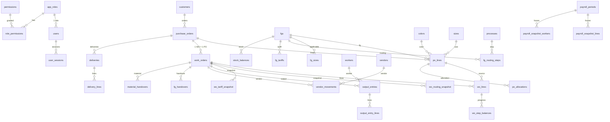

# Skema Database — GMS (PostgreSQL + EF Core Fluent API)

| Atribut | Nilai |
|---|---|
| Versi | 1.0 |
| Penulis | Software Architect |
| Sumber | `docs/FSD/*.md`, `docs/Architecture/ADR.md` |

## 0. Konvensi

- Tabel/kolom `snake_case`. PK `id uuid` (v7) kecuali dinyatakan lain. Jejak: `created_at timestamptz NOT NULL`, `created_by uuid`, `updated_at`, `updated_by` (pada tabel yang dapat diedit).
- `row_version` = `xmin` (konkurensi optimistis) pada tabel bertanda **[RV]**.
- Enum disimpan sebagai `text` + CHECK. Nilai enum ada di `Gms.Shared`.
- FK `RESTRICT` kecuali ditandai **CASCADE** (anak agregat).
- Tanggal bisnis `date`. Uang/tarif `numeric` (lihat ADR-003).
- Kode unik case-insensitive: kolom bertipe `citext` + indeks unik (implementasi aktual; tulisan "unik `lower(code)`" di tabel bawah bermakna sama).
- Semua tabel bertanda **[RV]** mewarisi kolom jejak `created_at/by`, `updated_at/by`.
- Pada kode: kolom `xmin` dipetakan lewat `IsRowVersion()`; Npgsql tidak membuatnya sebagai kolom (tidak ada di DDL).
- Seluruh tabel dikonfigurasi lewat Fluent API di `Gms.Infrastructure/Persistence/Configurations/<Modul>/`.

## 1. Gambaran Relasi (ringkas)

---

## 2. Access Management

### users (Identity, `AppUser : IdentityUser<Guid>`) [RV]
| Kolom | Tipe | Catatan |
|---|---|---|
| id | uuid PK | |
| user_name, normalized_user_name | text | Unik pada normalized (Identity). Username tidak dapat diubah (aturan aplikasi). |
| password_hash | text | Hash Identity |
| full_name | text NOT NULL | |
| role_id | uuid NOT NULL | FK → app_roles |
| is_active | bool NOT NULL | |
| must_change_password | bool NOT NULL | |
| lockout_end, access_failed_count, lockout_enabled | Identity | Lockout 5× / 15 menit |
| last_login_at | timestamptz | |
| created_at/by, updated_at/by | | |

Kolom Identity lain (email, phone, security_stamp, dll.) tetap ada tetapi tidak dipakai. Tabel `user_claims`, `user_logins`, `user_tokens` dibuat oleh Identity dan tidak dipakai (diabaikan atau dibiarkan kosong).

### app_roles [RV]
`id`, `name text NOT NULL` (unik `lower(name)`), `description text`, `is_system bool NOT NULL` (true = Administrator, tidak dapat diubah/dihapus).

### permissions (katalog, hasil seed)
| Kolom | Tipe | Catatan |
|---|---|---|
| key | text PK | `Resource.Action`, contoh `WorkOrder.Release` |
| resource | text NOT NULL | |
| action | text NOT NULL | |
| module | text NOT NULL | Pengelompokan matriks UI |
| description | text | |
| sort_order | int NOT NULL | |
| is_assignable | bool NOT NULL | false untuk `AccessManagement.*` (hanya Administrator) |

### role_permissions
PK `(role_id, permission_key)`. FK role **CASCADE**; FK permission RESTRICT.

### user_sessions
| Kolom | Tipe | Catatan |
|---|---|---|
| id | uuid PK | |
| user_id | uuid NOT NULL | FK → users |
| token_hash | bytea NOT NULL | SHA-256 dari token opaque |
| created_at, last_activity_at | timestamptz NOT NULL | |
| revoked_at | timestamptz | NULL = aktif |
| revoked_reason | text | `Logout`, `Timeout`, `Replaced`, `AdminForced`, `Deactivated`, `PasswordReset` |
| ip_address | text(64) | (sebelumnya `inet`; disederhanakan karena alamat berasal dari header proxy) |
| user_agent | text | |

**Indeks:** unik `(token_hash)`; **unik parsial `(user_id) WHERE revoked_at IS NULL`** (satu sesi aktif per pengguna).

### audit_logs (append-only)
`id bigint identity PK`, `occurred_at timestamptz NOT NULL`, `actor_user_id uuid`, `actor_username text`, `event_type text NOT NULL`, `target_type text`, `target_id text`, `old_value jsonb`, `new_value jsonb`, `ip_address text(64)`.
Indeks `(occurred_at DESC)`, `(actor_user_id, occurred_at DESC)`, `(event_type, occurred_at DESC)`.
**Trigger** `audit_logs_immutable` menolak UPDATE dan DELETE.

---

## 3. Master Data

Semua tabel master: `id`, `is_active bool NOT NULL DEFAULT true`, jejak, **[RV]**.

| Tabel | Kolom bisnis | Unik / Catatan |
|---|---|---|
| uoms | code, name | unik `lower(code)` |
| material_categories | code, name | unik `lower(code)` |
| materials | code, name, category_id→, uom_id→, description | unik `lower(code)` |
| sizes | code, name, sort_order int | unik `lower(code)` |
| colors | code, name, hex char(7) NULL | unik `lower(code)`; CHECK hex `^#[0-9A-Fa-f]{6}$` |
| customers | code (otomatis `CUS-0001`), name, contact_person, phone, address, notes | unik `lower(code)`, unik `lower(name)` |
| processes | code, name, type text (`Internal`/`Vendor`) | unik `lower(code)` |
| vendors | code (otomatis `VND-0001`), name, service_type, contact_person, phone, address, notes | unik `lower(code)` |
| workers | code (otomatis `PKJ-0001`), name, join_date date NULL, main_process_id→processes NULL, notes | unik `lower(code)` |
| fgs | code, name, kind text, customer_id→customers NULL, notes | unik `lower(code)` |

### fg_sizes (CASCADE dari fgs)
PK `(fg_id, size_id)`.

### fg_routing_steps (CASCADE dari fgs)
| Kolom | Catatan |
|---|---|
| id uuid PK | |
| fg_id, process_id | FK |
| seq int NOT NULL | ≥ 1 |

**Unik:** `(fg_id, process_id)` (satu proses sekali) dan `(fg_id, seq)` **DEFERRABLE INITIALLY DEFERRED** (agar reorder dalam satu transaksi tidak bentrok).

### fg_tariffs (CASCADE dari fgs)
| Kolom | Tipe |
|---|---|
| fg_id, process_id, size_id | PK komposit |
| rate | numeric(18,5) NOT NULL, `CHECK (rate > 0)` |

**FK komposit:** `(fg_id, process_id)` → `fg_routing_steps(fg_id, process_id)` **CASCADE** (menghapus langkah menghapus tarif) dan `(fg_id, size_id)` → `fg_sizes` **CASCADE**. Dengan demikian tarif hanya mungkin untuk langkah dan size yang sah. Bahwa langkah bertipe `Internal` ditegakkan aplikasi.

### number_sequences
`key text PK`, `next_value bigint NOT NULL`. Contoh key: `PO-202611`, `WO-202611`, `SJ-202611`, `CUS`, `VND`, `PKJ`.

---

## 4. Customer PO

### purchase_orders [RV]
| Kolom | Tipe | Catatan |
|---|---|---|
| id | uuid PK | |
| code | text NOT NULL | `PO-YYYYMM-NNNN`, unik |
| customer_id | uuid NOT NULL | FK |
| customer_po_number | text NULL | |
| po_date | date NOT NULL | |
| status | text NOT NULL | `Draft`, `Confirmed`, `InProgress`, `Completed`, `Cancelled` |
| notes | text | |
| cancel_reason | text | wajib bila Cancelled |
| confirmed_at/by | | |
| created_at/by, updated_at/by | | |

**Indeks:** unik parsial `(customer_id, lower(customer_po_number)) WHERE customer_po_number IS NOT NULL AND status <> 'Cancelled'`; `(status)`; `(customer_id)`; `(po_date DESC)`.

### po_lines [RV] (CASCADE dari purchase_orders)
| Kolom | Tipe | Catatan |
|---|---|---|
| id | uuid PK | |
| po_id | uuid NOT NULL | |
| fg_id, color_id, size_id | uuid NOT NULL | FK; **tanpa** FK ke fg_sizes (snapshot, FSD PO E6) |
| delivery_date | date NOT NULL | |
| qty | int NOT NULL | `CHECK (qty > 0 AND qty <= 1000000)` |
| notes | text | |
| **delivered_qty** | int NOT NULL DEFAULT 0 | proyeksi |
| **allocated_qty** | int NOT NULL DEFAULT 0 | proyeksi (alokasi aktif, belum terkirim) |
| **in_production_qty** | int NOT NULL DEFAULT 0 | proyeksi (ADR-004) |

**CHECK:** `delivered_qty >= 0 AND allocated_qty >= 0 AND in_production_qty >= 0 AND delivered_qty + allocated_qty + in_production_qty <= qty`.
**Unik:** `(po_id, fg_id, color_id, size_id, delivery_date)`. Indeks `(po_id)`, `(fg_id, color_id, size_id)`, `(delivery_date) WHERE delivered_qty < qty`.
*Sisa Rencana* = `qty − delivered − allocated − in_production` (hasil hitung).

### po_allocations (append-only)
| Kolom | Catatan |
|---|---|
| id bigint identity PK | |
| po_line_id | FK |
| kind | `Allocate`, `Release`, `Consume`, `ReverseConsume` |
| qty int | `CHECK (qty > 0)` |
| source | `Manual`, `Handover`, `HandoverVoid`, `PoCancel`, `Delivery`, `DeliveryVoid` |
| source_id uuid NULL | dokumen sumber |
| reason text | |
| created_at, created_by | |

Indeks `(po_line_id, id)`.

---

## 5. Work Order

### work_orders [RV]
| Kolom | Tipe | Catatan |
|---|---|---|
| id | uuid PK | |
| code | text NOT NULL | `WO-YYYYMM-NNNN`, unik |
| po_id | uuid NOT NULL | FK (1 WO = 1 PO) |
| fg_id | uuid NOT NULL | FK (1 WO = 1 FG) |
| fg_code, fg_name | text | snapshot label (diisi saat dibuat, dikunci saat Release) |
| start_date, target_date | date NULL | CHECK `target_date >= start_date` |
| status | text NOT NULL | `Draft`, `Released`, `InProgress`, `Completed`, `Closed`, `Cancelled` |
| notes, cancel_reason | text | |
| released_at/by, completed_at/by, closed_at/by | | |
| created_at/by, updated_at/by | | |

Indeks `(po_id)`, `(status)`, `(fg_id)`, `(target_date) WHERE status IN ('Released','InProgress','Completed')`.

### wo_lines [RV] (CASCADE dari work_orders)
| Kolom | Catatan |
|---|---|
| id uuid PK, wo_id, po_line_id | FK |
| qty int | `CHECK (qty > 0)` |
| handed_over_qty int NOT NULL DEFAULT 0 | proyeksi: total serah terima FG aktif |
| color_code, color_name, size_code, size_name text | snapshot label |

Unik `(wo_id, po_line_id)`. Indeks `(po_line_id)`.

### wo_status_history (CASCADE)
`id`, `wo_id`, `from_status`, `to_status`, `reason`, `changed_at`, `changed_by`.

### wo_routing_snapshot (CASCADE; dibuat saat Release, tidak berubah)
PK `(wo_id, seq)`: `process_id`, `process_code`, `process_name`, `process_type`.

### wo_tariff_snapshot (CASCADE; dibuat saat Release, tidak berubah)
PK `(wo_id, seq, size_id)`: `size_code`, `rate numeric(18,5) NOT NULL CHECK (rate > 0)`. FK `(wo_id, seq)` → `wo_routing_snapshot`.
Hanya langkah bertipe `Internal` yang memiliki baris.

### wo_step_balances (proyeksi progres)
PK `(wo_line_id, seq)`:
| Kolom | Arti |
|---|---|
| qty int NOT NULL | Output kumulatif langkah Internal, atau **diterima** untuk langkah Vendor |
| sent_qty int NOT NULL DEFAULT 0 | **terkirim** (langkah Vendor saja) |

`CHECK (qty >= 0 AND sent_qty >= 0)`. Baris dibuat saat Release untuk setiap `wo_line × langkah`. Dipakai untuk validasi invariant dan matriks progres.

---

## 6. Production Output

### output_entries (ledger; metadata status saja yang berubah)
| Kolom | Tipe | Catatan |
|---|---|---|
| id | uuid PK | |
| wo_id | uuid NOT NULL | FK |
| seq | int NOT NULL | langkah routing (Internal) |
| worker_id | uuid NOT NULL | FK |
| work_date | date NOT NULL | |
| kind | text NOT NULL | `Output`, `Adjustment` |
| status | text NOT NULL | `Active`, `Voided` |
| original_date | date NULL | wajib bila `Adjustment` |
| replaces_entry_id | uuid NULL | hasil Koreksi |
| ref_entry_id | uuid NULL | rujukan entri asal (Penyesuaian) |
| reason | text | wajib: Adjustment, Koreksi |
| void_reason, voided_at, voided_by | | |
| created_at, created_by | | |

FK komposit `(wo_id, seq)` → `wo_routing_snapshot`. **CHECK:** `kind <> 'Adjustment' OR (original_date IS NOT NULL AND reason IS NOT NULL)`; `status <> 'Voided' OR void_reason IS NOT NULL`.
**Indeks:** `(wo_id, seq, status)`; **payroll:** `(work_date, worker_id) WHERE status = 'Active'`; `(worker_id, work_date)`.

### output_entry_lines (CASCADE)
PK `(entry_id, wo_line_id)`, `qty int NOT NULL CHECK (qty <> 0)`. Qty negatif hanya sah bila entri `Adjustment` (ditegakkan aplikasi).

### vendor_movements
Sama pola: `id`, `wo_id`, `seq` (langkah Vendor), `vendor_id`, `kind` (`Send`/`Receive`), `movement_date date`, `doc_no`, `notes`, `status`, `replaces_id`, `void_reason/at/by`, `created_*`. FK komposit `(wo_id, seq)` → `wo_routing_snapshot`.
### vendor_movement_lines (CASCADE)
PK `(movement_id, wo_line_id)`, `qty int CHECK (qty > 0)`.

> Per-vendor `Diterima ≤ Terkirim` divalidasi dari agregat entri aktif (`vendor_movement_lines` dijumlahkan per vendor × wo_line) di bawah kunci WO.

---

## 7. Serah Terima dan Stok FG

### fg_handovers
`id`, `wo_id`, `handover_date date`, `doc_no`, `received_by text`, `notes`, `status` (`Active`/`Voided`), `replaces_id`, `void_reason/at/by`, `created_*`. Indeks `(wo_id)`, `(handover_date DESC)`.
### fg_handover_lines (CASCADE)
PK `(handover_id, wo_line_id)`: `qty int CHECK (qty > 0)`, **`auto_allocated_qty int NOT NULL DEFAULT 0`** (bagian yang dialokasikan otomatis ke PO, untuk pembalikan).

### stock_balances (proyeksi)
PK `(fg_id, color_id, size_id)`: `on_hand int`, `allocated int`.
`CHECK (on_hand >= 0 AND allocated >= 0 AND allocated <= on_hand)`. *Tersedia* = `on_hand − allocated`.

### stock_ledger (append-only)
| Kolom | Catatan |
|---|---|
| id bigint identity PK | |
| fg_id, color_id, size_id | |
| kind | `HandoverReceipt`, `HandoverReversal`, `Delivery`, `DeliveryReversal`, `Adjustment`, `OpeningBalance` |
| qty int | bertanda (±), `CHECK (qty <> 0)` |
| source_type, source_id | dokumen sumber |
| entry_date date | |
| reason text | wajib untuk `Adjustment` |
| created_at, created_by | |

Indeks `(fg_id, color_id, size_id, id)` untuk kartu stok (saldo berjalan lewat window function).

### material_handovers
`id`, `wo_id`, `handover_date`, `doc_no`, `notes`, `status`, `void_reason/at/by`, `created_*`.
### material_handover_lines (CASCADE)
`id`, `handover_id`, `material_id`, `qty numeric(18,3) CHECK (qty > 0)`, `uom_code text` (snapshot), `notes`.

---

## 8. Pengiriman

### deliveries [RV]
| Kolom | Catatan |
|---|---|
| id, code (`SJ-YYYYMM-NNNN`, unik), po_id | |
| delivery_date date | |
| recipient_name, vehicle, driver, notes | opsional |
| status | `Active`/`Voided` |
| replaces_id, void_reason/at/by | |
| print_count int NOT NULL DEFAULT 0 | cetakan ke-2 dst. = "CETAK ULANG" |
| created_*, updated_* | |

Indeks `(po_id)`, `(delivery_date DESC)`.
### delivery_lines (CASCADE)
PK `(delivery_id, po_line_id)`, `qty int CHECK (qty > 0)`.

---

## 9. Payroll

### payroll_periods [RV]
| Kolom | Catatan |
|---|---|
| id, code (`GJ-YYYYMMDD-YYYYMMDD`, unik) | |
| start_date, end_date date | `CHECK (end_date >= start_date)` |
| status | `Open`/`Closed` |
| notes | |
| closed_at, closed_by | |
| total_paid numeric(18,0) NULL | terisi saat Closed |
| created_*, updated_* | |

**Constraint:** `EXCLUDE USING gist (daterange(start_date, end_date, '[]') WITH &&)` (tanpa tumpang tindih); **indeks unik parsial** `((true)) WHERE status = 'Open'` (hanya satu Open).
Kontiguitas (tanpa celah) divalidasi aplikasi saat pembuatan: `start_date = end_date periode terakhir + 1`.

### payroll_snapshot_lines (CASCADE; dibuat saat Closed)
`id bigint identity PK`, `period_id`, `worker_id`, `worker_code`, `worker_name`, `wo_id`, `wo_code`, `process_code`, `process_name`, `size_code`, `work_date`, `kind` (`Output`/`Adjustment`), `original_date NULL`, `reason NULL`, `qty int`, `rate numeric(18,5)`, `subtotal numeric(28,5)`, `source_entry_id uuid`.
Indeks `(period_id, worker_id, work_date)`.

### payroll_snapshot_workers (CASCADE; dibuat saat Closed)
PK `(period_id, worker_id)`: `worker_code`, `worker_name`, `total_qty int`, `sum_before_rounding numeric(28,5)`, `paid_amount numeric(18,0)`.

---

## 10. Seed Data (WAJIB, dijalankan idempoten)

| Seed | Isi |
|---|---|
| Katalog permission | Semua `Resource.Action` dari `Gms.Shared` (lihat ApiConventions.md bagian 6). Menambah, tidak menimpa. |
| Role Administrator | `is_system = true`, memiliki semua permission |
| Pengguna Administrator awal | username dari konfigurasi, password dari `Seed:AdminPassword`, `must_change_password = true`. Hanya bila belum ada Administrator. |
| Customer "STOK INTERNAL" | untuk PO produksi stok |
| Data demo (hanya Development/UAT) | Size (S–3XL), Color, Process (CUT, EMB(Vendor), SEW, QC, FIN, PCK), FG contoh dengan routing+tarif, Pekerja, Customer, PO, WO, output sehingga QA/Frontend dapat menguji tanpa input manual |

---

## 11. Pemetaan Invariant ke Mekanisme

| Invariant (FSD) | Penegak |
|---|---|
| Satu sesi aktif per pengguna (AC-AM-06a) | Indeks unik parsial `user_sessions` |
| Kode/username unik (AC-MD-02) | Indeks unik `lower(code)` |
| Satu proses sekali dalam routing (Q2) | Unik `(fg_id, process_id)` |
| Tarif > 0, presisi 5 desimal | `CHECK (rate > 0)`, `numeric(18,5)` |
| Tarif hanya untuk langkah+size yang sah | FK komposit CASCADE |
| Sisa Rencana ≥ 0 | CHECK pada `po_lines` + kunci |
| Stok tidak negatif; tersedia ≥ 0 | CHECK pada `stock_balances` |
| Nomor PO customer unik per customer | Indeks unik parsial |
| Hanya satu periode gaji Open; tanpa tumpang tindih | Indeks unik parsial + exclusion constraint |
| Aturan kumulatif output | Kunci WO + validasi kondisi akhir (aplikasi) + `wo_step_balances` |
| Tutup periode vs input | `FOR SHARE`/`FOR UPDATE` pada `payroll_periods` |
| Audit tidak dapat diubah | Trigger pada `audit_logs` |
| Snapshot WO tidak berubah | Tidak ada jalur update (aplikasi) |

---

## 12. Perkiraan Volume (untuk indeks)

5–6 pengguna, puluhan PO/bulan, puluhan WO aktif. `output_entries` adalah tabel paling besar: perkiraan puluhan ribu baris per bulan. Indeks pada bagian 6 cukup. Tidak ada partisi pada fase 1.

---

## 13. Migrasi (EF Core) dan Status Implementasi

| Migrasi | Isi |
|---|---|
| `Initial` | 47 tabel (termasuk tabel Identity `users`, `user_claims`, `user_logins`, `user_tokens`), 33 CHECK constraint, indeks unik parsial, FK (termasuk FK komposit), ekstensi `citext` dan `btree_gist` |
| `AdvancedConstraints` | SQL eksplisit: unik `(fg_id, seq)` DEFERRABLE pada `fg_routing_steps`; exclusion constraint `ex_payroll_periods_no_overlap`; trigger `audit_logs` anti UPDATE/DELETE/TRUNCATE |

Lokasi: `src/Backend/Gms.Infrastructure/Persistence/Migrations/`. Perintah: `dotnet tool restore` lalu
`dotnet tool run dotnet-ef migrations add <Nama> --project src/Backend/Gms.Infrastructure --startup-project src/Backend/Gms.Api --output-dir Persistence/Migrations`.
Untuk menjalankan ke database: set `GMS_DESIGN_CONNECTION` (tanpa menaruh kredensial di repository) lalu `dotnet tool run dotnet-ef database update ...`.

**Status verifikasi (jujur):** model dan DDL tervalidasi oleh `dotnet ef migrations add` dan skrip SQL (`migrations script`) berhasil dibuat. **Belum dijalankan terhadap PostgreSQL nyata** (Docker Desktop tidak aktif saat tahap Architect). Tugas pertama Backend: menjalankan migrasi pada PostgreSQL (Testcontainers/Docker) dan menguji constraint kunci (sesi tunggal, periode tumpang tindih, CHECK stok/Sisa Rencana, trigger audit).

Catatan: tabel passkey Identity 10 tidak dibuat (fitur tidak dipakai). Nama PK/FK/indeks otomatis EF (mis. `PK_po_lines`) belum di-snake_case; kosmetik, dapat dirapikan Backend.
